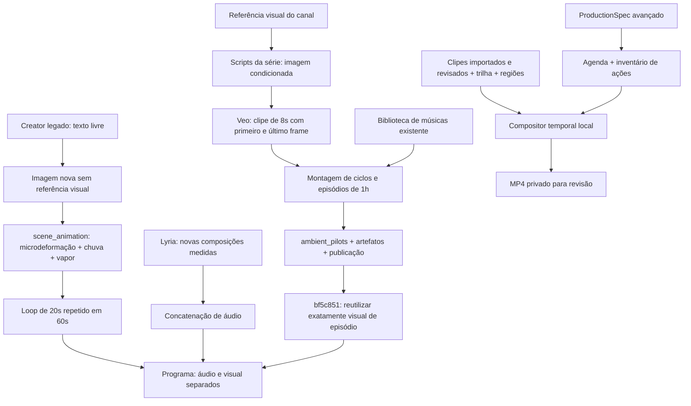

# 01 — Arquitetura real e escopo da auditoria

Data: 15/10/2026 (America/Sao_Paulo). Código de referência: `bf5c851`.

## Parecer inicial

**Verificado:** há uma plataforma funcional, com catálogo, geração musical, publicação de episódios, fontes separadas de áudio/vídeo, motor local de microanimação e compositor temporal. Há **três caminhos visuais distintos**, que não devem ser tratados como equivalentes. Não é necessário reconstruir a plataforma.

**Decisão do responsável:** Greenhouse Rain Study, Snowy Night Studio e Autumn Bookshop Coding são a baseline visual aprovada. A confirmação recebida durante esta auditoria prevalece para a avaliação artística. Seus registros `ambient_pilots.status=review` / `human_visual_review=pending` são divergências de registro, não reprovação dos arquivos. Esta auditoria não modificou aprovações no banco.

**Limites:** nenhuma geração paga, render longo, publicação, transmissão, migração ou alteração em código de aplicação. Testes usam PostgreSQL descartável. Leituras de produção usam transações `READ ONLY`; amostras e análises de mídia não geram novos conteúdos. Não se afirma revisão humana de uma hora inteira de áudio ou de cada frame.

## Fluxos reais

### Caminho A — episódios aprovados

**Verificado no script preservado da VPS:** `generate_visual.py` / `generate_wide.py` usam `input_references` com `brand-reference.png`; a animação usa Veo com primeiro e último frame derivados da imagem. O registro é feito por `deliver_episode_remote.py`, com arquivos, relatórios e hashes. Os scripts estavam no cache operacional, fora do repositório Git auditado; foram preservados como evidência, sem executá-los. Os relatórios indicam fonte animada curta e repetição dentro da hora. Isso não significa uma hora de gestos inéditos.

### Caminho B — referência 8-bit defeituosa

**Verificado:** o plano `LOFI-3A590745` não tinha `production_spec`. O caminho original chamou geração de imagem sem `input_references`, adicionou instruções de ilustração painterly e posições fixas, e aplicou `scene_animation.render`. Esse motor não faz carinho, saída/retorno do gato ou consulta ao celular. A ausência desses movimentos é limitação do caminho usado, não um evento programado que tenha sido executado com sucesso.

Fontes: `studio/creator_service.py`, funções `visual` (linha 12), `package` (58), `tick` (88); `studio/scene_animation.py:10–64`; histórico anterior a `bf5c851`.

**Estado atual verificado:** o programa de 2 minutos passou a apontar para o visual Greenhouse, mas a sequência original defeituosa permanece em `visual_cycle_key` e no asset histórico. Não foi excluída. Isso exige quarentena/rotulagem futura para evitar seleção acidental. O código `bf5c851` exige um episódio publicado de 1h para novas produções no fluxo legado, e reutiliza o arquivo visual original; esse caminho não adiciona novos gestos.

### Caminho C — harness e compositor temporal

**Verificado:** `ProductionSpec` compila agenda em segundos absolutos, ações, iluminação e fingerprints; `assembly_plan` exige clipes revisados. O compositor executa os clipes, máscaras de ambiente e transições. O motor não sintetiza sozinho os clipes de ações ausentes.

Fontes: `studio/production_harness.py:11–109,154–191`; `studio/timeline_api.py`; `studio/timeline_compositor.py:35–46,107–161`; `studio/timeline_worker.py:31–86`.

A compilação inspecionada de uma hora produz 32 eventos e 40 segmentos, totalizando 3.600s sem sobreposição de intervalos. Os 11 tipos de clipes estão ausentes no inventário dos roteiros existentes. Uma referência de interação de 8s aprovada existe em um roteiro de 8h; não é um conjunto completo de ações.

## Operação observada

- API e Creator: imagem `production-bf5c851`; exportador/compositor: `production-a3a08c9`.
- Quatro programas prontos no catálogo: três programas anteriores de aproximadamente 4/8h e a referência de 121,78s. Os dois roteiros de 60min encontrados são rascunhos sem programa gerado; não há novo vídeo de uma hora concluído nesta auditoria.
- Canal parado; publisher parado. Nenhum desses estados foi alterado pela auditoria.
- VPS: 4 CPUs lógicas, cerca de 7,8 GiB RAM; aproximadamente 20 GB livres em 154 GB. Limites dos containers: API 0,4 CPU/420MiB; Creator 0,8 CPU/768MiB; exportador 0,2 CPU/384MiB. Esses limites não constituem benchmark de render de 1/4/8h.
- Dependências: Python/FFmpeg/Pillow/NumPy; FastAPI/Pydantic; PostgreSQL; Redis; armazenamento S3. Versões observadas em `evidence/production-before.json` e pins em `requirements.txt`.
- Isolamento já implementado por schema e prefixo de armazenamento (`studio/tenancy.py`). A auditoria não expande nem remove multi-tenant.

## Evidências reproduzíveis

- `evidence/production-before.json`: contagens, metadados, manifests, estados e digests de preservação; nenhum valor de variável de ambiente exportado.
- `evidence/code-index.json`: hash de cada arquivo e localização de funções no commit auditado.
- `evidence/timeline-inspection.json`: compilação gratuita da agenda atual.
- `evidence/python-tests.txt` e `interface-tests.json`: testes em ambiente descartável.
- `evidence/media-evidence.json`: verificação de cópias e medições, quando anexada após concluir a leitura.

Declarações sobre direitos/licença ou semelhança musical não são inferidas da existência de arquivos. Nenhuma promessa de monetização ou retenção integra o parecer.
