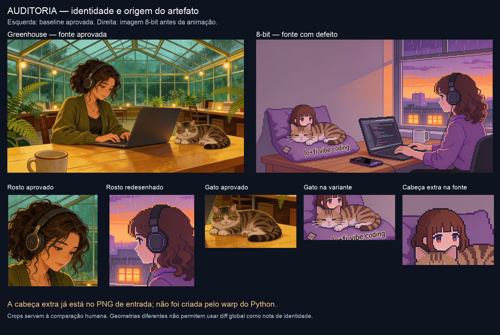
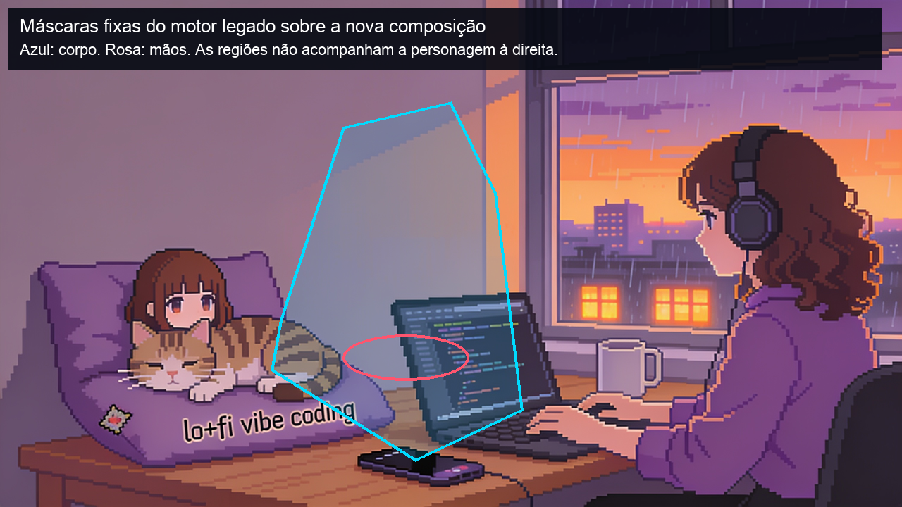
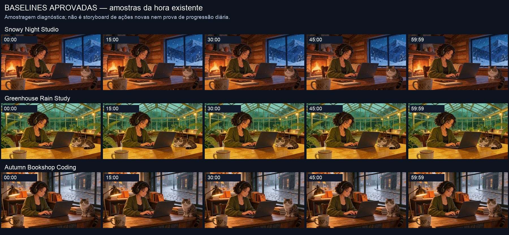

# Auditoria SDD v2 — Lo-Fi Studio

**Concluída em 15/10/2026.** Escopo: investigar e documentar; nenhuma correção estrutural ou nova geração foi executada.

## Parecer

Os três vídeos de 1h aprovados pelo responsável estão íntegros. **15 verificações de pares cache/S3** coincidiram com os hashes registrados. Foram preservados localmente imagens, fontes de movimento, recibos e um snapshot do código. Não é necessário reconstruir a plataforma.

A regressão da referência 8-bit veio de um caminho diferente: **imagem nova sem a referência visual + microanimação local com máscaras fixas**. A cabeça extra já existia no PNG anterior à animação. Os vídeos aprovados foram solicitados com referência visual e clipes de movimento condicionados, depois montados em ciclos. Não há evidência de que trocar apenas a cor da blusa tenha causado o erro.

O compositor temporal existe, mas faltam assets/revisões para a sequência completa de ações. A agenda atual ainda é a antiga; **15/30/45 é a decisão para a próxima implementação**, preservando o preset legado. Reutilizar a animação aprovada mantém a identidade, mas não implementa automaticamente carinho, celular ou passagem de tempo.

## Entregáveis

1. [Arquitetura real e versões em produção](01-AS_IS.md)
2. [Inventário e preservação](02-INVENTARIO.md)
3. [Regressões, causas e evidências](03-REGRESSOES_E_CAUSAS.md)
4. [Matriz completa FR/NFR e riscos](04-GAP_ANALYSIS.md)
5. [Arquitetura incremental proposta](05-ARQUITETURA_INCREMENTAL.md)
6. [Testes e critérios de aceite](06-TESTES_E_CRITERIOS.md)
7. [Backlog priorizado e rollback](07-BACKLOG_INCREMENTAL.md)
8. [Decisões e limites](08-DECISOES_E_LIMITES.md)
9. [Áudio, proveniência e custos](09-AUDIO_PROVENIENCIA_E_CUSTOS.md)
10. [Lacunas atuais após a recuperação SDD v2](10-LACUNAS_POS_RECUPERACAO.md): substitui a matriz 04 como lista viva; 01–09 refletem `bf5c851`

## Evidências visuais

A montagem diagnóstica local de 8s com as três fontes originais está em `outputs/auditoria-sdd-v2/movimento-original-3-referencias.mp4`, na ordem Snowy → Greenhouse → Autumn. É uma comparação de assets existentes, não um novo programa ou preview fiel de uma hora com eventos adicionais.

## Verificações concluídas

- 90 testes Python e 6 verificações de interface passaram; isso não certifica arte/retenção nem movimentos ausentes.
- Três visuais sem áudio: H.264, 1280×720, 24fps, 3.600s.
- Decode atual das três trilhas sem erro. Picos amostrais entre −3,1 e −2,2dBFS. Trechos de volume muito baixo foram listados para audição, sem reprovar ou editar a baseline.
- Snapshot do código restaurado em área descartável: 23 hashes conferidos; fontes de movimento locais decodificadas e imagens/clipes verificados.
- Digests antes/depois iguais; mesmas contagens, jobs, tarefas, publicações e canal parado. Nenhum deploy, ajuste de token/teto, upload ou início de live.

## Próxima correção mínima proposta

Consolidar os perfis de referência aprovados, quarentenar o asset defeituoso para novos usos e exigir vínculo de fonte em todos os caminhos. Depois validar recolor localizado e uma ação compatível em trecho curto, antes de qualquer render longo. O backlog detalha dependências e rollback; **essas correções ainda não foram implementadas pela auditoria**.

## Limites explícitos

Aprovação artística do responsável foi respeitada; flags pendentes no banco são divergência de registro. Não foram auditadas juridicamente licenças nem ouvidas todas as 241 faixas. O catálogo tem QA `not_run`, embora o analisador exista. Backup integral off-site/imutabilidade não foi confirmado. A nova medição LUFS completa foi limitada operacionalmente; os recibos históricos vinculados por hash estão separados das medições atuais de pico/silêncio. Não há promessa de custo por hora, monetização, naturalidade automática ou capacidade nova de 8h.

## Rastreabilidade

Código auditado: `bf5c851`. Evidências principais: `production-before.json`, `production-after.json`, `preservation-result.json`, `media-evidence.json`, `asset-inventory.json`, `code-index.json`, `requirement-trace.json` e logs de testes, todos em `evidence/`. O SDD é referência de requisitos, não prova de que as capacidades desejadas já existam. Relatos, hipóteses e propostas estão identificados nos relatórios.
